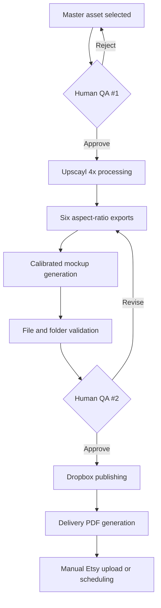
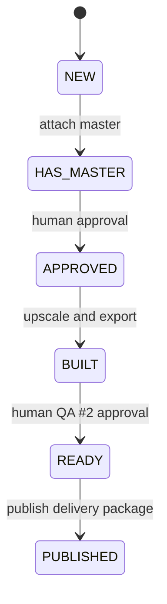
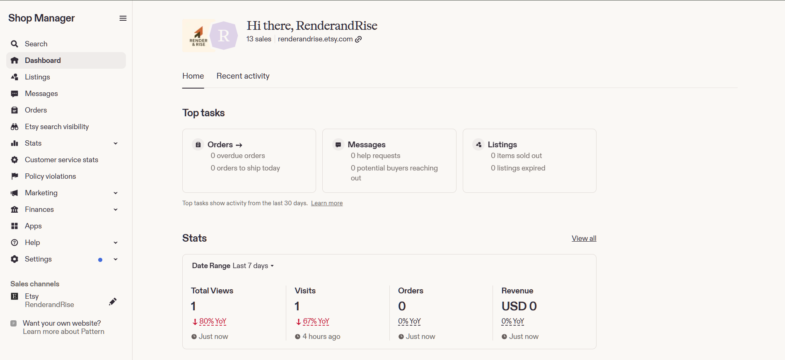
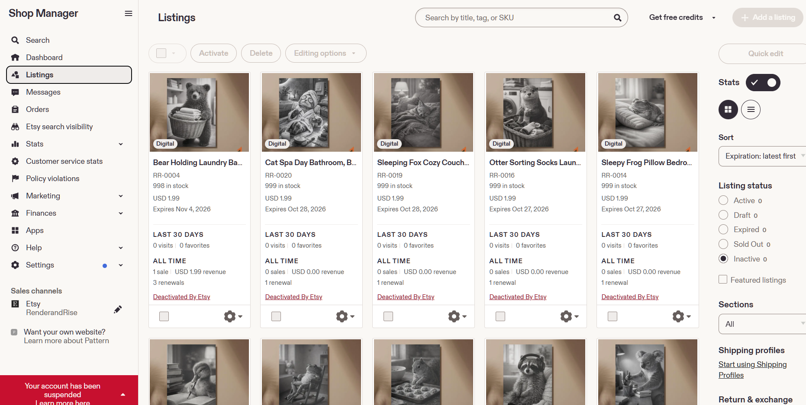
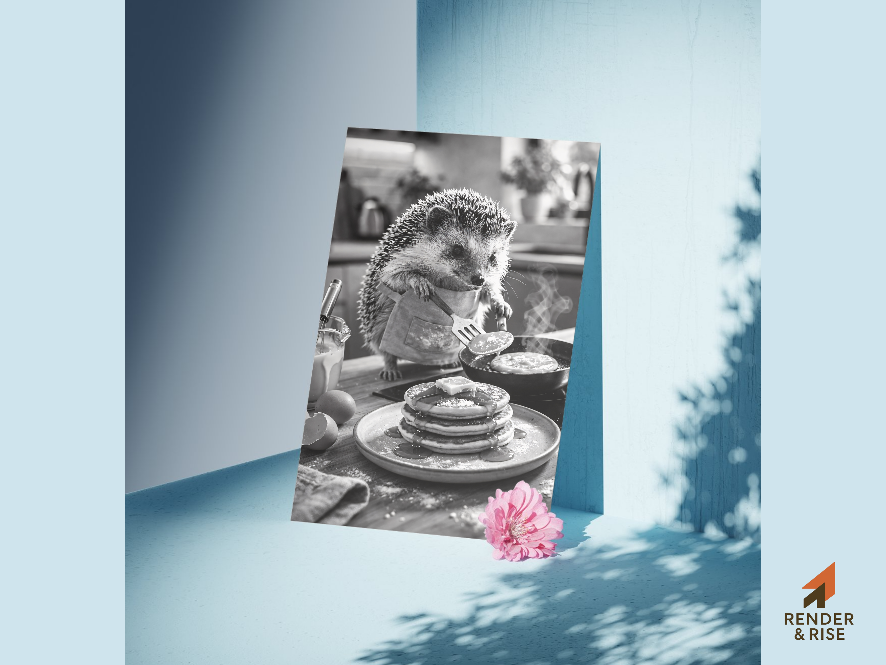
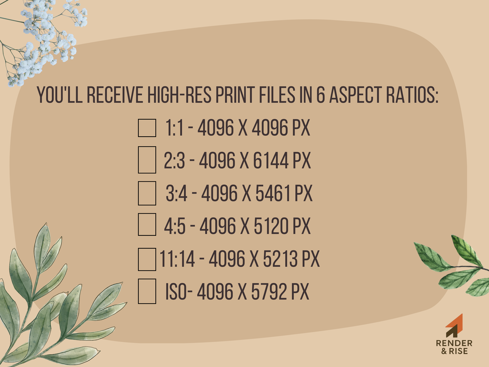

# Render & Rise Automation Pipeline

A Python-based human-in-the-loop automation system for producing and packaging digital wall-art products.

Render & Rise began as a small Etsy experiment while I was studying Electrical Engineering and evolved into an engineering project focused on eliminating repetitive production work while retaining human quality-control checkpoints.

> **Status:** Built, deployed, and validated against a live Etsy storefront, with a later Shop Manager record showing 13 sales. The commercial storefront is now inactive; the automation system is maintained as an engineering portfolio project.

## Overview

The application coordinates a local product queue, image processing, calibrated mockup generation, Dropbox delivery, and customer PDF creation through a PySide6 desktop interface. It is semi-automated by design: software handles deterministic, repeatable steps while a person owns creative selection and customer-facing approval.

## The Problem

Each digital-art listing required the same error-prone work: upscale a master, crop it for six print ratios, place it into multiple mockups, package the files, publish delivery assets, and keep the product record synchronized. Doing that manually made naming, dimensions, folders, and delivery links easy to get wrong.

## The Solution

Render & Rise turns one approved master asset into a consistent delivery package. A CSV-backed queue records each product's state, the GUI exposes controlled actions, and validation prevents missing inputs from silently moving forward.

## System Architecture



The final Etsy publication step was deliberately left manual. Automation is strongest at deterministic production work; subjective quality and customer-facing decisions remain human responsibilities.

## Automated Workflow



The pipeline provides queue/state management, upscaling, saliency-aware crops, six printable ratios (`1:1`, `2:3`, `3:4`, `4:5`, `11:14`, and ISO A), lighting-aware mockups, Dropbox upload, delivery-PDF generation, and structured error reporting.

## Human-in-the-Loop QA

There are two intentional review gates:

1. **Before processing:** select the master and confirm composition, artifacts, and print suitability.
2. **Before sale:** inspect exports, mockups, naming, delivery contents, and the final listing presentation.

This prevents an incorrect generated or composited asset from silently reaching a customer.

## Key Features

- CSV-backed product queue with explicit workflow states
- Local PySide6 GUI with previews, progress reporting, and guarded actions
- Configurable Upscayl integration with environment-based path discovery
- Saliency-aware export crops across six printable aspect ratios
- Red/green calibration pairs for per-pixel mockup placement and lighting
- Idempotent Dropbox folder creation and overwrite-safe publishing
- Customer delivery PDFs with real embedded hyperlinks
- Resume-friendly folders, validation checks, and actionable exceptions

## Technology Stack

Python, PySide6, OpenCV, NumPy, Pillow, Dropbox SDK, python-docx, docx2pdf, pathlib, CSV, and Upscayl.

## Screenshots / Gallery

| Live-store evidence | Published listing catalogue |
| --- | --- |
|  |  |

| Master asset | Calibrated wall mockup |
| --- | --- |
|  |  |

| Alternate product mockup | Six-ratio delivery guide |
| --- | --- |
|  |  |

These are representative production artifacts. The repository intentionally excludes the full multi-gigabyte product archive.

## Repository Structure

```text
render-and-rise-automation/
├── assets/                  # Contracts for local delivery and mockup templates
├── config/                  # Local configuration guidance
├── docs/images/             # Six representative portfolio images
├── examples/                # Walkthrough of the operator workflow
├── sample_data/             # Synthetic, privacy-safe queue rows
├── src/render_and_rise/     # GUI, orchestration, image, Dropbox, and PDF modules
├── tests/                   # Core crop and link-normalization tests
├── .env.example             # Placeholder-only environment variables
├── .gitignore
├── pyproject.toml
└── requirements.txt
```

## Example Workflow

An operator creates a queue row, attaches a master, performs QA, and marks it `APPROVED`. The application upscales it, builds six export folders, and creates calibrated mockups. After reviewing the final outputs, the operator explicitly approves QA #2 to enter `READY`, publishes the delivery files to one human-readable Dropbox folder, generates a linked PDF locally, and manually uploads or schedules the Etsy listing.

## Reliability / Validation

- State transitions make incomplete work visible instead of implicit.
- Missing masters, exports, templates, credentials, and external executables fail with specific errors.
- Dropbox folder creation and file upload operations are safe to repeat.
- Calibration data is derived from paired reference renders and can be cached locally.
- Queue writes preserve extra columns so workflow metadata is not discarded.
- Secrets, delivery links, production queues, generated products, caches, and logs are excluded from Git.

## Live-Market Validation

- The pipeline supported a real Etsy storefront and approximately 20 published listings.
- The later available Shop Manager record shows **13 sales**.
- That later record also shows the Etsy account suspended and the listings deactivated.
- The commercial experiment is no longer operating; budget constraints contributed to discontinuing it.
- The software is maintained and documented here as an automation-engineering portfolio project.

This is evidence of deployment and learning, not a claim that the business was commercially successful.

## Lessons Learned

The project reinforced that reliable automation is mostly about state, validation, reproducible naming, and well-placed human decisions. It also showed why credentials and generated customer artifacts must be separated from source code, and why external services need idempotent operations and clear failure messages.

## Current Status

The included code reflects the working local production system with targeted cleanup for public release. It is a portfolio snapshot, not a hosted SaaS product. The Etsy storefront is inactive, production credentials and links are not included, and privately licensed mockup source files must be supplied locally.

## Running Locally

Requirements: Python 3.10+, Upscayl for 4x processing, a Dropbox app for cloud publishing, and Microsoft Word on Windows if converting a local DOCX delivery template with `docx2pdf`.

```powershell
git clone https://github.com/OmarNayyar/render-and-rise-automation.git
cd render-and-rise-automation
python -m venv .venv
.venv\Scripts\Activate.ps1
pip install -e ".[dev]"
Copy-Item .env.example .env
New-Item -ItemType Directory -Force data
Copy-Item sample_data\products_queue.sample.csv data\products_queue.csv
render-rise-gui
```

Add real Dropbox and Upscayl settings only to your local `.env`. Supply your own delivery documents and place mockup templates you own or are licensed to use under `assets/mockup_templates/`, as described in [assets/README.md](assets/README.md).

No open-source license is granted by this repository.
